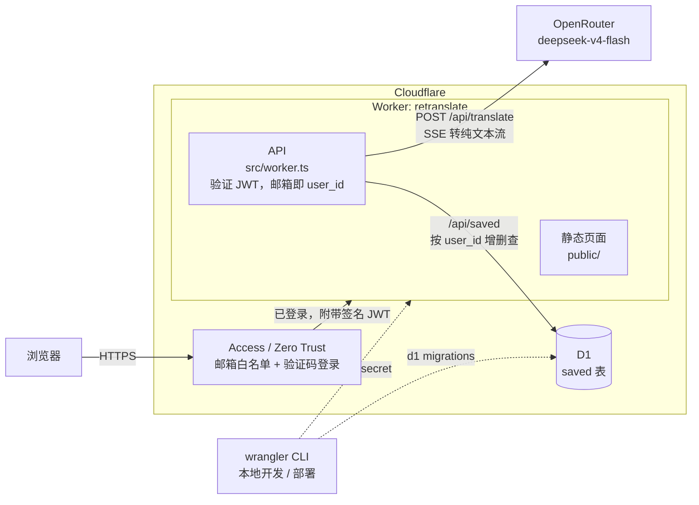

# retranslate

单页面翻译工具，DeepL 的精简版。打开即用：Cmd+Tab 切过来，粘贴，看译文。

- 中、英、德互译，自动检测原文语言；原文和目标语言相同时改为润色
- 粘贴后立即翻译，流式输出；单词会给出词义（德语带冠词和复数）
- `⌘S` 保存当前翻译，`⌘⇧S` 把所有保存的条目导出为 CSV
- 通过 Cloudflare Access 限定使用者，每人只能看到自己保存的内容

## 架构



| 组件 | 职责 |
|---|---|
| Access | 挡在 Worker 前面，只放行白名单邮箱，通过的请求附带签名 JWT |
| Worker | 托管页面；校验 JWT（签名、iss、aud、exp），以邮箱作为 `user_id` |
| `/api/translate` | 调 OpenRouter（关闭推理，优先低延迟服务商，设价格上限），把 SSE 转成纯文本流 |
| `/api/saved` | D1 读写，按 `(user_id, source, target_lang)` 去重 |
| 前端 | 纯 HTML/CSS/JS，无构建步骤 |

## 本地运行

```bash
npm install
npx wrangler d1 migrations apply retranslate --local
npx wrangler dev --var DEV_USER:you@local   # OPENROUTER_API_KEY 从 .env 读取
npm test
```

## 文档

- [`PLAN.md`](PLAN.md)：设计决策和取舍
- [`DEPLOY.md`](DEPLOY.md)：部署、Access 配置、日常运维、排错
